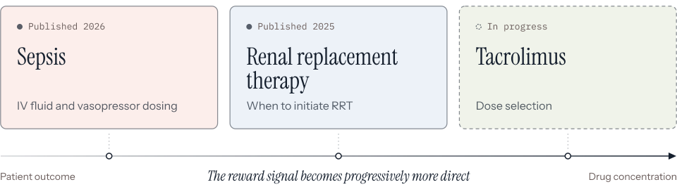

<picture>
  <source media="(prefers-color-scheme: dark)" srcset="assets/header-dark.svg">
  
</picture>

<a href="https://scholar.google.com/citations?user=tVbfK3AAAAAJ"><picture><source media="(prefers-color-scheme: dark)" srcset="assets/btn-scholar-dark.svg"></picture></a>
<a href="https://www.linkedin.com/in/mohammad-mahdi-azarbeik-757597201/"><picture><source media="(prefers-color-scheme: dark)" srcset="assets/btn-linkedin-dark.svg"></picture></a>
<a href="mailto:mm.azarbeik@gmail.com"><picture><source media="(prefers-color-scheme: dark)" srcset="assets/btn-email-dark.svg"></picture></a>

I'm a PhD candidate in Computer Science at [TU Wien](https://www.tuwien.at/) (Institute of Logic and Computation) and a researcher at the [Medical University of Vienna](https://www.meduniwien.ac.at/), where I work with the Clinical Division of General Anaesthesia and Intensive Care Medicine.

I apply offline reinforcement learning to treatment decisions in the intensive care unit: learning policies from retrospective electronic health records, then evaluating them off-policy with the statistical care that clinical claims require.

## Dissertation

One offline RL pipeline, built on the [AI Clinician](https://doi.org/10.1038/s41591-018-0213-5) framework and extended across three clinical problems. A second sepsis manuscript is in preparation.

<picture>
  <source media="(prefers-color-scheme: dark)" srcset="assets/research-dark.svg">
  
</picture>

## Publications

- `2026` **Learning and evaluating improved reinforcement learning-based policies for sepsis treatment on MIMIC-IV.** *Journal of Critical Care*
- `2025` **Optimal timing for renal replacement therapy using reinforcement learning.** *Journal of Critical Care*
- `2024` **TU Wien at SemEval-2024: Hallucination detection in LLMs.** *SemEval-2024*
- `2023` **Augmenting inertial motion capture with SLAM using EKF and SRUKF.** *Measurement*

The full list is on [Google Scholar](https://scholar.google.com/citations?user=tVbfK3AAAAAJ).

## Positions

- `2025–now` **Medical University of Vienna**, Researcher
- `2025–2026` **Ludwig Boltzmann Institute for Digital Health and Patient Safety**, Researcher
- `2023–2025` **TU Wien**, University Assistant. Taught Reinforcement Learning, Generative AI and LLMs, and Data-oriented Programming.

## Other work

Alongside clinical RL, I have worked on state estimation for robotics, fusing inertial motion capture with SLAM, and on hallucination detection in large language models. I also contribute to [EU-TRAINS](https://cordis.europa.eu/project/id/101130495), a Horizon Europe project, on AI-driven wearables for exercise performance monitoring.

## Tools

`Python` `PyTorch` `TensorFlow` `scikit-learn` `SQL` `PostgreSQL` `BigQuery` `GCP` `Docker` `Git` `MATLAB` `ROS`

## Get in touch

I'm interested in multi-agent RL for collaborative clinical decisions, what it takes to deploy clinical AI at the bedside, and federated learning on sensitive clinical data. If you work on any of these, or on offline RL in healthcare generally, write to me at [mm.azarbeik@gmail.com](mailto:mm.azarbeik@gmail.com).
