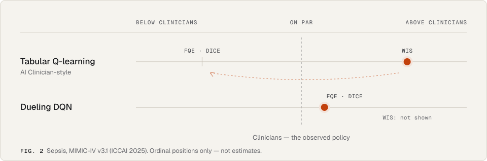

<picture>
  <source media="(prefers-color-scheme: dark)" srcset="assets/header-dark.svg">
  
</picture>

<a href="https://mazarbeik.github.io/azarbeik/"><picture><source media="(prefers-color-scheme: dark)" srcset="assets/btn-website-dark.svg"></picture></a>
<a href="https://scholar.google.com/citations?user=tVbfK3AAAAAJ"><picture><source media="(prefers-color-scheme: dark)" srcset="assets/btn-scholar-dark.svg"></picture></a>
<a href="https://orcid.org/0000-0003-0780-4928"><picture><source media="(prefers-color-scheme: dark)" srcset="assets/btn-orcid-dark.svg"></picture></a>
<a href="https://www.linkedin.com/in/mohammad-mahdi-azarbeik-757597201/"><picture><source media="(prefers-color-scheme: dark)" srcset="assets/btn-linkedin-dark.svg"></picture></a>
<a href="mailto:mm.azarbeik@gmail.com"><picture><source media="(prefers-color-scheme: dark)" srcset="assets/btn-email-dark.svg"></picture></a>
<a href="https://mazarbeik.github.io/azarbeik/cv/Azarbeik_CV.pdf"><picture><source media="(prefers-color-scheme: dark)" srcset="assets/btn-cv-dark.svg"></picture></a>

I'm a PhD candidate in Computer Science at [TU Wien](https://www.tuwien.at/en/) and a researcher at the [Medical University of Vienna](https://www.meduniwien.ac.at/), in the Department of Anaesthesia, Intensive Care Medicine and Pain Medicine. I learn treatment policies for the intensive care unit from retrospective health records with **offline reinforcement learning**, and evaluate them **off-policy** — with the statistical care that clinical claims require.

## Research

My dissertation starts from the [AI Clinician](https://doi.org/10.1038/s41591-018-0213-5) approach to sepsis and carries offline RL over to a second decision: when to start renal replacement therapy. The recurring problem is evaluation. A policy learned from records can't be tried on patients, so its value has to be estimated from data the clinicians generated — and the estimator can change the verdict.

<picture>
  <source media="(prefers-color-scheme: dark)" srcset="assets/verdict-dark.svg">
  
</picture>

In my sepsis study on MIMIC-IV, tabular Q-learning appears to beat clinicians under weighted importance sampling (WIS) but falls below them under fitted Q-evaluation (FQE) and DICE estimators, while a Dueling DQN performs at clinician level, with slight improvements under the more robust estimators. WIS tended to overestimate the RL agents.

| | Sepsis | Renal replacement therapy |
|:--|:--|:--|
| **Decision** | IV fluid and vasopressor dosing | When to initiate RRT in acute kidney injury |
| **Data** | MIMIC-IV v3.1 | MIMIC-IV v2.2 · 31,269 ICU patients |
| **Learning** | Tabular Q-learning, Dueling DQN | RL algorithms incl. actor-critic |
| **Evaluation** | WIS vs. FQE, DualDICE, GenDICE, GradientDICE | High-confidence off-policy evaluation (95% lower bound) |
| **Output** | Conference abstract, ICCAI 2025 · full manuscript in preparation | Conference abstract, ICCAI 2024 · preprint, 2025 |
| **Role** | First author (abstract) | Co-author |

## Publications

- `2026` **Learning and evaluating improved reinforcement learning-based policies for sepsis treatment on MIMIC-IV.** *Journal of Critical Care* 92 · conference abstract, ICCAI 2025 · first author · [doi](https://doi.org/10.1016/j.jcrc.2025.155385)
- `2025` **Optimized renal replacement therapy decisions in intensive care: A reinforcement learning approach.** *Research Square* · preprint · Kapral, Bologheanu, Azarbeik et al. · [doi](https://doi.org/10.21203/rs.3.rs-6243566/v1)
- `2025` **Optimal timing for renal replacement therapy in critically ill patients using reinforcement learning algorithms.** *Journal of Critical Care* 86 · conference abstract, ICCAI 2024 · Kapral, Azarbeik et al. · [doi](https://doi.org/10.1016/j.jcrc.2024.154964)
- `2024` **TU Wien at SemEval-2024 Task 6: Unifying model-agnostic and model-aware techniques for hallucination detection.** *SemEval-2024* (ACL) · Arzt, Azarbeik et al. · [paper](https://doi.org/10.18653/v1/2024.semeval-1.173) · [code](https://github.com/kleines-gespenst/shroom-hackathon)
- `2023` **Augmenting inertial motion capture with SLAM using EKF and SRUKF data fusion algorithms.** *Measurement* 222 · first author · [doi](https://doi.org/10.1016/j.measurement.2023.113690) · [arXiv](https://arxiv.org/abs/2302.08294) · [dataset](https://doi.org/10.21227/yaxm-6273)
- `2022` **An overview of the design experience and group analysis of a spinning ride from the perspective of engineering education.** *Iranian Journal of Engineering Education* 24(94) · Meghdari et al. · [doi](https://doi.org/10.22047/ijee.2022.321010.1874)

## Also

- **Hallucination detection in LLMs** — SemEval-2024 shared task (SHROOM): model-agnostic and model-aware detectors combined by ensembling. Our TU Wien system ranked **3rd** on the model-aware track (80.6% accuracy).
- **State estimation and sensor fusion** — my M.Sc. work at Sharif University of Technology: quaternion EKF and square-root UKF fusing low-cost IMUs with SLAM to track a human arm, validated against VICON (best case 5.87 cm / 1.1°).
- **EU-TRAINS** (2025–2026) — I was lead researcher for the Ludwig Boltzmann Institute for Digital Health and Patient Safety on this [Horizon Europe project](https://cordis.europa.eu/project/id/101130495), coordinated by Silicon Austria Labs: AI-enabled wearable sensors for multisport training and remote healthcare.

## Positions

- `2025–now` **Researcher**, Medical University of Vienna — deep RL agents and robust off-policy evaluation for ICU decision support
- `2025–2026` **Researcher**, Ludwig Boltzmann Institute for Digital Health and Patient Safety — EU-TRAINS
- `2023–2025` **University Assistant**, TU Wien — offline RL for clinical decision support, LLM hallucination detection

Teaching assistant for Reinforcement Learning, Generative AI and Data-oriented Programming Paradigms at TU Wien, and Numerical Analysis at K. N. Toosi University of Technology. Reviewer for *PLOS Digital Health*, *Measurement*, *Journal of Intelligent & Robotic Systems* and *IEEE Sensors Journal*.

## Toolbox

`Python` `PyTorch` `TensorFlow` `scikit-learn` `SQL` `PostgreSQL` `BigQuery` `Google Cloud` `MIMIC-IV` `Git` `Linux` `MATLAB` `ROS`

---

I'm interested in multi-agent RL for collaborative clinical decisions, in what it takes to bring clinical AI to the bedside, and in federated learning on sensitive clinical data. If you work on any of these — or on offline RL in healthcare generally — write to me at [mm.azarbeik@gmail.com](mailto:mm.azarbeik@gmail.com).
