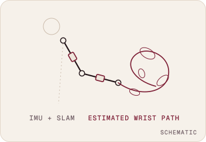
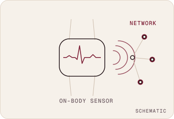
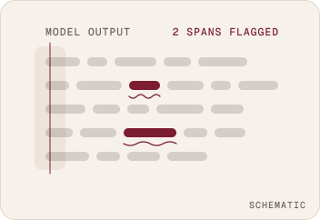
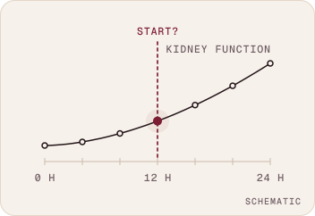
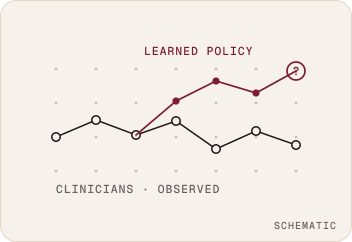
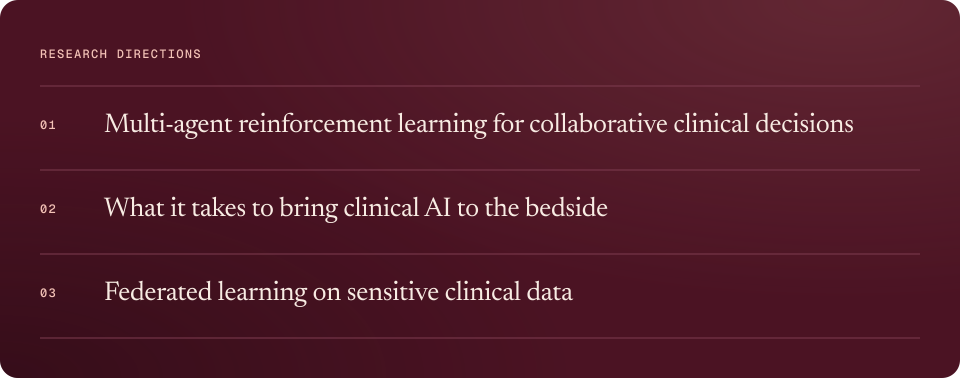

<picture>
  <source media="(prefers-color-scheme: dark)" srcset="assets/header-dark.svg">
  
</picture>

<a href="https://mazarbeik.github.io/azarbeik/"><picture><source media="(prefers-color-scheme: dark)" srcset="assets/btn-website-dark.svg"></picture></a>
<a href="https://scholar.google.com/citations?user=tVbfK3AAAAAJ"><picture><source media="(prefers-color-scheme: dark)" srcset="assets/btn-scholar-dark.svg"></picture></a>
<a href="https://orcid.org/0000-0003-0780-4928"><picture><source media="(prefers-color-scheme: dark)" srcset="assets/btn-orcid-dark.svg"></picture></a>
<a href="https://www.linkedin.com/in/mohammad-mahdi-azarbeik-757597201/"><picture><source media="(prefers-color-scheme: dark)" srcset="assets/btn-linkedin-dark.svg"></picture></a>
<a href="mailto:mm.azarbeik@gmail.com"><picture><source media="(prefers-color-scheme: dark)" srcset="assets/btn-email-dark.svg"></picture></a>
<a href="https://mazarbeik.github.io/azarbeik/cv/Azarbeik_CV.pdf"><picture><source media="(prefers-color-scheme: dark)" srcset="assets/btn-cv-dark.svg"></picture></a>

I'm Mahdi, a machine-learning researcher in Vienna. I'm a researcher at the [Medical University of Vienna](https://www.meduniwien.ac.at/) and a PhD candidate in Computer Science at [TU Wien](https://www.tuwien.at/en/). My background is in mechanical engineering, where I worked on state estimation and sensor fusion; the common thread through my work since is quantifying how reliable an estimate is.

## Research

My work spans three fields, shown here in the order I came to them. Across all three, the aim is to learn from imperfect data and to quantify how far the results can be trusted.

<picture>
  <source media="(prefers-color-scheme: dark)" srcset="assets/fields-dark.svg">
  
</picture>

### 01 · Sensing & estimation

Kalman filtering and sensor fusion that turn low-cost, noisy sensor signals into reliable estimates of motion, together with their remaining uncertainty.

<table>
<tr>
<td width="300"><a href="https://mazarbeik.github.io/azarbeik/#motion"><picture><source media="(prefers-color-scheme: dark)" srcset="assets/project-motion-dark.svg"></picture></a></td>
<td>

**Inertial motion capture with SLAM** 
2023 · First author

Fusing drifting inertial sensors with camera-based SLAM in extended and square-root unscented Kalman filters to track a human arm, validated against an optical motion-capture system.

Journal article in *Measurement* (2023), with an open dataset and a graphical-abstract video. 
[DOI](https://doi.org/10.1016/j.measurement.2023.113690) · [arXiv](https://arxiv.org/abs/2302.08294) · [Dataset](https://doi.org/10.21227/yaxm-6273) · [Video (MP4)](https://mazarbeik.github.io/azarbeik/assets/media/measurement-graphical-abstract.mp4)

</td>
</tr>
<tr>
<td width="300"><a href="https://mazarbeik.github.io/azarbeik/#eu-trains"><picture><source media="(prefers-color-scheme: dark)" srcset="assets/project-wear-dark.svg"></picture></a></td>
<td>

**AI-enabled wearables: EU-TRAINS** 
2025–2026 · Horizon Europe

Lead researcher for the Ludwig Boltzmann Institute for Digital Health and Patient Safety on a Horizon Europe project developing AI-enabled wearables for multisport training and remote healthcare.

Funded by Horizon Europe, grant agreement 101130495. 
[CORDIS](https://cordis.europa.eu/project/id/101130495) · [Project site](https://eu-trains.eu/)

</td>
</tr>
</table>

### 02 · Learning systems

Offline reinforcement learning, which learns decision policies from logged data rather than by trial and error, and off-policy evaluation of those policies; these are the methods behind the clinical work in 03. Also hallucination detection in large language models.

<table>
<tr>
<td width="300"><a href="https://mazarbeik.github.io/azarbeik/#hallucination"><picture><source media="(prefers-color-scheme: dark)" srcset="assets/project-halluc-dark.svg"></picture></a></td>
<td>

**Hallucination detection in language models** 
2024 · TU Wien team

Detecting hallucinations in language-model outputs (SemEval-2024 Task 6) with an ensemble that combines black-box detectors and detectors reading the model's internal activations.

Ranked 3rd in the model-aware track and 8th in the model-agnostic track; paper in the SemEval-2024 proceedings (ACL). 
[Paper (PDF)](https://mazarbeik.github.io/azarbeik/papers/arzt-azarbeik-2024-semeval-hallucination.pdf) · [DOI](https://doi.org/10.18653/v1/2024.semeval-1.173) · [Team code](https://github.com/kleines-gespenst/shroom-hackathon)

</td>
</tr>
</table>

### 03 · Clinical decision support

Treatment strategies for sepsis and renal replacement therapy, learned from intensive-care records, evaluated with several off-policy methods and reviewed with physicians for clinical plausibility.

<table>
<tr>
<td width="300"><a href="https://mazarbeik.github.io/azarbeik/#rrt"><picture><source media="(prefers-color-scheme: dark)" srcset="assets/project-rrt-dark.svg"></picture></a></td>
<td>

**Timing renal replacement therapy** 
2024–2025 · Co-author

Learning when to start renal replacement therapy in critically ill patients with acute kidney injury, using reinforcement learning with high-confidence off-policy evaluation.

Conference abstract in *Journal of Critical Care* (ICCAI 2024); preprint on Research Square (2025). 
[Abstract](https://doi.org/10.1016/j.jcrc.2024.154964) · [Preprint](https://doi.org/10.21203/rs.3.rs-6243566/v1)

</td>
</tr>
<tr>
<td width="300"><a href="https://mazarbeik.github.io/azarbeik/#sepsis"><picture><source media="(prefers-color-scheme: dark)" srcset="assets/project-sepsis-dark.svg"></picture></a></td>
<td>

**Treatment strategies for sepsis** 
2025 · First author

Learning fluid and vasopressor dosing policies for sepsis from intensive-care records (MIMIC-IV), and comparing off-policy evaluation methods, whose choice can change which policy appears best.

Conference abstract in *Journal of Critical Care* (ICCAI 2025, Vienna); full paper in preparation. 
[Abstract](https://doi.org/10.1016/j.jcrc.2025.155385)

</td>
</tr>
</table>

## Publications

- `2026` **Learning and evaluating improved reinforcement learning-based policies for sepsis treatment on MIMIC-IV** 
  **M. M. Azarbeik**, L. Kapral, R. Weiss, C. Heitzinger, O. Kimberger. *Journal of Critical Care* 92, 155385. Conference abstract, ICCAI 2025. [DOI](https://doi.org/10.1016/j.jcrc.2025.155385)
- `2025` **Optimized renal replacement therapy decisions in intensive care: A reinforcement learning approach** 
  L. Kapral, R. Bologheanu, **M. M. Azarbeik**, A. Bilir, R. Weiss, S. Bartos, S. Schaller, C. Heitzinger, E. Schaden, O. Kimberger. *Research Square*. Preprint. [DOI](https://doi.org/10.21203/rs.3.rs-6243566/v1)
- `2025` **Optimal timing for renal replacement therapy in critically ill patients using reinforcement learning algorithms** 
  L. Kapral, **M. M. Azarbeik**, R. Weiss, R. Bologheanu, C. Heitzinger, O. Kimberger. *Journal of Critical Care* 86, 154964. Conference abstract, ICCAI 2024. [DOI](https://doi.org/10.1016/j.jcrc.2024.154964)
- `2024` **TU Wien at SemEval-2024 Task 6: Unifying model-agnostic and model-aware techniques for hallucination detection** 
  V. Arzt, **M. M. Azarbeik**, I. Lasy, T. Kerl, G. Recski. *Proceedings of the 18th International Workshop on Semantic Evaluation (SemEval-2024)*, ACL, pp. 1183–1196. Workshop paper. [PDF](https://mazarbeik.github.io/azarbeik/papers/arzt-azarbeik-2024-semeval-hallucination.pdf) · [DOI](https://doi.org/10.18653/v1/2024.semeval-1.173) · [Code](https://github.com/kleines-gespenst/shroom-hackathon)
- `2023` **Augmenting inertial motion capture with SLAM using EKF and SRUKF data fusion algorithms** 
  **M. M. Azarbeik**, H. Razavi, K. Merat, H. Salarieh. *Measurement* 222, 113690. Journal article. [DOI](https://doi.org/10.1016/j.measurement.2023.113690) · [arXiv](https://arxiv.org/abs/2302.08294) · [Data](https://doi.org/10.21227/yaxm-6273)
- `2022` **An overview of the design experience and group analysis of a spinning ride from the perspective of engineering education** 
  A. Meghdari, S. M. J. Zolanvari, H. Izanlo, M. S. Tohidi Nafe, **M. M. Azarbeik**, et al. *Iranian Journal of Engineering Education* 24(94), pp. 39–60. Journal article, in Persian. [DOI](https://doi.org/10.22047/ijee.2022.321010.1874)

Also listed on [Google Scholar](https://scholar.google.com/citations?user=tVbfK3AAAAAJ) and [ORCID](https://orcid.org/0000-0003-0780-4928).

## Experience

<picture>
  <source media="(prefers-color-scheme: dark)" srcset="assets/path-dark.svg">
  
</picture>

**Teaching assistant.** Reinforcement Learning, Generative AI and Data-oriented Programming Paradigms at TU Wien; Numerical Analysis at K. N. Toosi University of Technology.

**Peer review.** *PLOS Digital Health*, *Measurement*, *Journal of Intelligent & Robotic Systems* and *IEEE Sensors Journal*.

**Toolkit.** `Python` `PyTorch` `TensorFlow` `scikit-learn` `SQL` `BigQuery` `PostgreSQL` `Google Cloud` `Git` `MIMIC-IV` `ViennaAIdb` `MATLAB` `ROS` `Arduino`

## Next

<picture>
  <source media="(prefers-color-scheme: dark)" srcset="assets/next-dark.svg">
  
</picture>

I'm glad to discuss research on reinforcement learning in healthcare, clinical decision support and the evaluation of clinical AI. Email is the best way to reach me: [mm.azarbeik@gmail.com](mailto:mm.azarbeik@gmail.com).
